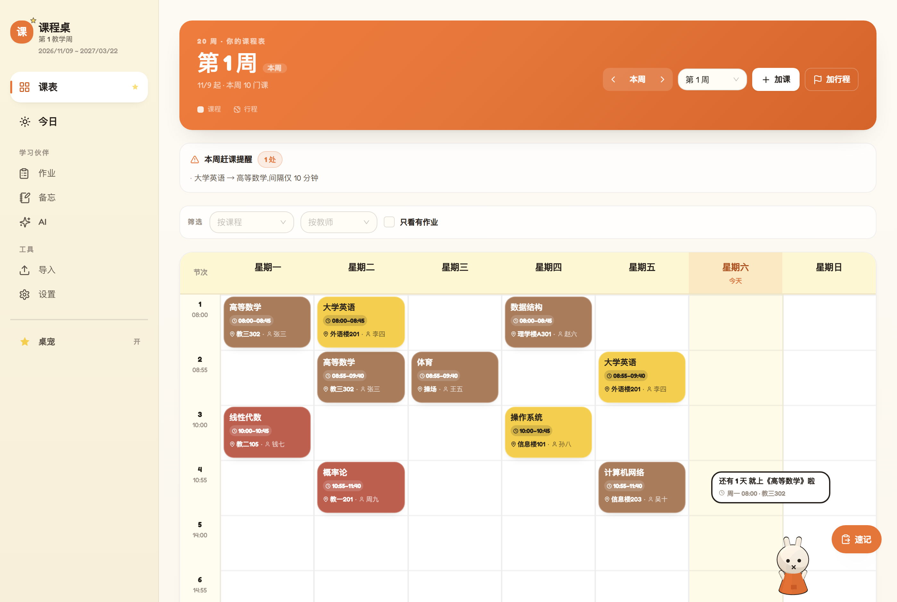
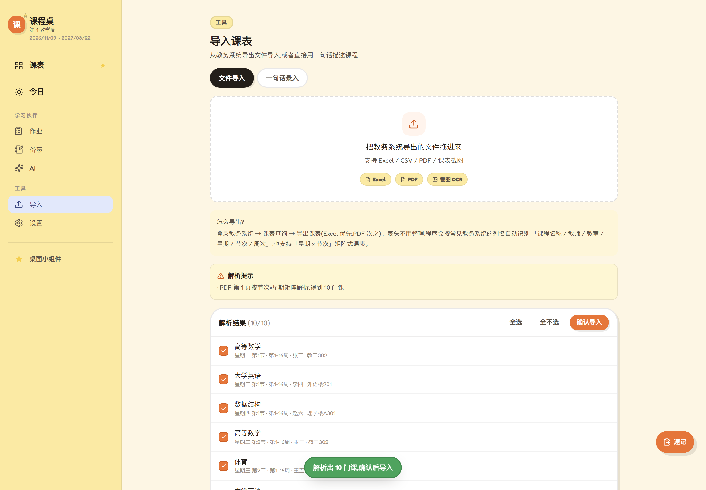
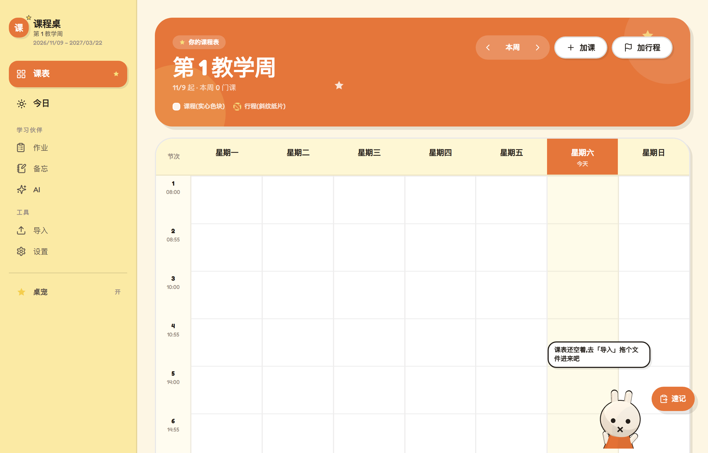
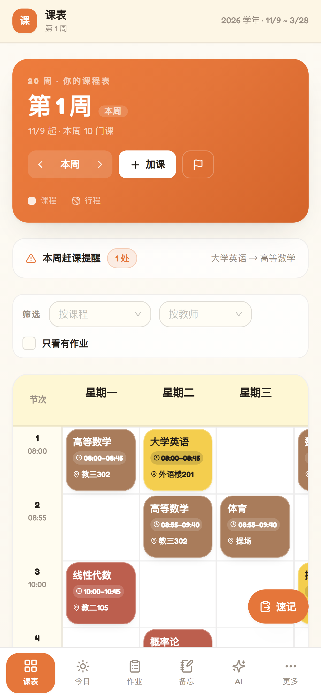

# 课程桌 CourseDesk

**大学生用的电子课表。** 打开就是你的课,能装到手机和电脑桌面上,不用注册、数据只存在你自己的设备里。

**[👉 点这里直接用](https://yuanxuru-oss.github.io/course-desk/)**



---

# 一、它有什么

就是一张**你自己的课表**,外加几件大学生每天都要做的事:

| 功能 | 干什么的 |
|---|---|
| **课表** | 一周七天,每节课写清几点到几点、在哪、谁上;可以拖拽改时间 |
| **今日** | 打开就知道下一节课是什么、还有几分钟、今天还有什么没做 |
| **作业** | 记作业、设截止时间、勾完成;「每周五交周记」这种可以一次设置、自动每周生成 |
| **备忘** | 文字 + 图片笔记,可以关联到某门课 |
| **行程** | 开会、讲座、聚餐、党会这种"不是课但要去"的事,单独一类 |
| **提醒** | 上课前、作业到期前提醒你(系统通知 / 微信 / 浏览器推送) |
| **导入** | 教务系统导出的 Excel、PDF、课表截图,拖进来就变成课表 |
| **AI**(可选) | 把自己的课件笔记丢进去,问它重点;不配也完全不影响上面所有功能 |

这些是基本盘。下面才是它跟别的课表不一样的地方。

---

# 二、跟别的课表比,不一样在哪

一句话:**别的课表让你"手动把课填进去",这个想让你"把课表扔进来就能用"。**

---

## 1️⃣ 最烂的教务 PDF,也能直接导进来

大部分课表 App 要你一门一门手填,或者只认"规规矩矩的 Excel"。
但教务系统导出的 PDF 长这样:格子窄、字被挤成三行、**老师名字在一个字中间断开**。

```
《线性代数》,王
五,教三302,第14-16
周
```

这个能认出来 —— 因为有表格线,它按**真实格子**一格一格还原,把断掉的字拼回去,
最后认出:**课程名、老师、教室、第几周、星期几、第几节**。不是猜,是按 PDF 自己画的线还原的。

| | 别的课表 | 课程桌 |
|---|---|---|
| 教务 PDF | 让你手动重填 | 拖进来直接认 |
| 老师名被拆开 | 认成两门课 | 自动拼回来 |
| 一个格子里两门课 | 只剩一门 | 拆成两门 |
| 同一门课分好几段周次 | 重复成好几条 | 合并成一条,换老师写进备注 |



> 除了文件,还能**说一句话**加课:`周三下午3点高等数学 教三302`。

---

## 2️⃣ 微信里那条通知,复制一下就变成行程

学生会开会、党会、讲座、聚餐 —— 通知都在微信里。看完就忘,是常态。

在课程桌里,**复制那条消息,按 Ctrl+V**(手机点右下角「速记」),直接变成一张卡片:

```
识别到一条行程
学生会例会
11/12 周三 · 19:00–20:00
⚑ 会议   地点:学生活动中心301
[改一下]            [加到课表]
```

不用打开任何表单,不用打字。而且**粘到输入框里它不会来烦你** —— 只在你"随便一粘"的时候才出手。

> 这是别的课表完全没有的东西:它们只有"课程",没有"从聊天记录里认出一件事"这条路径。

---

## 3️⃣ 课程和活动,长得不一样

大部分课表只有一种东西:课程。于是"班会""讲座""部门例会"只能硬塞成课程,混在一起分不清。

课程桌里它们是**两种材质**:

| | 课程 | 活动 / 行程 |
|---|---|---|
| 样子 | 实心彩色块 | 米白纸片 + 斜纹 + 虚线框 |
| 颜色 | 八色轮转 | 固定藕紫,永远不会跟课程撞色 |
| 顺带 | — | 自动同步一条备忘,带时间地点 |

看一眼就知道"这节是课,那个是会"。

---

## 4️⃣ 作息能按学校改,整张表的时间跟着变

每个学校都不一样:有的 8:00 上课、有的 8:30;有的 45 分钟一节、有的 40;上午 4 节、下午 3 节……

在「设置 → 作息时间」改一次,**所有课的时间都跟着变**,连"第 3 节"落在几点几分都算对。
（还内置了 5 套常见作息,一键套用。）

> 顺手做了个**赶课提醒**:两节课挨着但教室离得远,页头会提醒你提前走。

---

## 5️⃣ 作业不用每周重记一遍

设一次「每周五 23:59 交高数周记」,之后**每周自动生成一条**。
勾掉这周的,下周的已经在那儿了。

---

## 6️⃣ 数据在你手里,不在别人的服务器上

绝大多数在线课表要注册账号,数据存在人家服务器:哪天关停、限流、涨价,你只能干瞪眼。

课程桌:

- **不用注册**,打开就能用
- 数据存在**你这台设备的浏览器**里,不上传
- 随时能导出成一个 JSON 文件(课表、作业、备忘、图片都在里面),换设备导入就行

---

## 7️⃣ 桌宠:一只住在桌面上的小兔(3D)

侧栏点「桌宠」会说明两种形态。**推荐用桌面版**:一只真正浮在桌面上的小兔,**浏览器最小化或关掉也还在**。



- **是 3D 的**:WebGL 实时渲染,卡通着色 + 粗黑描边(不支持 3D 的设备自动退回 2D 版)
- **自己会动**:隔一会儿走两步、发呆,好久没人理就趴下睡着,耳朵还会跟着甩
- **拖得动、甩得出去**:抓着它扔,落地会弹一下
- **点一下看今天的安排**:今天几节课、下一节几点、哪份作业快到期
- **会看人**:鼠标移动时它会偏头看你;被拎起来时眼睛会睁大
- **跟课表联动**:开始上课、有新作业,它会蹦一下并说话
- 位置记在本地,下次打开还在你放的地方;不想要了点「桌宠」关掉

> 底层是「状态机 + 物理循环」,和 vscode-pets、agent-pet-hub 那类桌宠一个套路:状态有最短保持时间防抖、自主行为定时器、拖拽带初速度和重力。

> 说明:米菲(Miffy / Nijntje)是 Mercis bv 的注册角色,所以这只兔子是**同一套造型语言**(白身子、粗黑描边、点点眼、×嘴、橘色小裙子)的原创形象,不是米菲本尊。

---

## 8️⃣（加分项）AI 只回答"你自己资料里"的内容

课件、笔记、讲义丢进去,问它「这门课的考试重点是什么」。
它**只从你的资料里找答案**,找不到就说"资料里没有",不会瞎编。

> 不想配 AI 也行 —— 课表、作业、备忘、提醒、导入**全都不依赖它**。不配的话知识库照样能"关键词搜索"。

---

# 三、三分钟用起来

### 第 1 步:打开

手机或电脑浏览器打开 **https://yuanxuru-oss.github.io/course-desk/**

### 第 2 步:把课表弄进来(选一种)

| 方式 | 怎么做 |
|---|---|
| 拖文件 | 「导入」→ 把教务系统导出的 Excel / PDF 拖进去 → 勾选要的课 → 确认导入 |
| 说一句话 | 「导入 → 一句话录入」→ 输入 `周三下午3点高数 教三302` |
| 手动加 | 课表页右上角「+ 加课」 |

### 第 3 步:装到桌面(强烈建议)

- **电脑**:Chrome / Edge 打开后,点地址栏右侧的**安装图标** → 变成独立窗口的 App
- **安卓**:浏览器菜单 →「安装应用」
- **iPhone**:Safari → 分享 →「添加到主屏幕」



装完有独立图标,断网也能打开。

### 想要「真·桌宠」:浮在其他窗口上面的那种

网页做不到透明置顶窗口,得套一层壳(Electron)。仓库里已经写好了:

```bash
# 首次会下载约 100MB 运行时,国内建议先设镜像
# PowerShell: $env:ELECTRON_MIRROR="https://npmmirror.com/mirrors/electron/"
npm install
npm run desktop
```

出来的是一个**透明、无边框、置顶、不挡鼠标**的小窗:只有一只兔子站在桌面上,
**眼神跟着你的系统鼠标转**(头转、眼珠偏),拖得动,双击打开课程桌,右键退出。

细节和实现说明在 [desktop/README.md](desktop/README.md)。

---

# 四、几个大家都会问的问题

**Q:一定要配 AI 吗?**
不用。不配也能用全部主功能,一分钱不花。

**Q:我的课表能认出来吗?**
Excel、PDF、截图都能试。格式特别怪的 PDF,把文件发给作者,通常加一条规则就能适配。

**Q:手机和电脑同步吗?**
不自动同步。靠"导出 → 导入"搬,因为不想让你注册账号。

**Q:会收费吗?**
不会。个人做的小工具,没有服务器成本(除非你自己开推送服务)。

**Q:数据安全吗?**
数据不出设备,没有账号也就没有"服务器泄露"这回事。AI 的 Key 也只存在浏览器里。

---

# 五、给想改代码的人

技术栈:**React + TypeScript + Vite + Tailwind + Dexie(IndexedDB)**,纯前端 PWA。

```bash
npm install
npm run dev        # 本地开发
npm run build      # 生产构建
npm test           # 单测(475 项断言)
node scripts/smoke-e2e.mjs   # 端到端冒烟(需要本机 Chrome)
```

架构、PDF 还原思路、判重与提醒的实现细节,写在 [docs/技术说明.md](docs/技术说明.md)。

---

## 说明

个人项目,给大学生日常用。不用注册、没有广告、不上传数据。
有问题或想要的功能,开个 Issue 就行。
